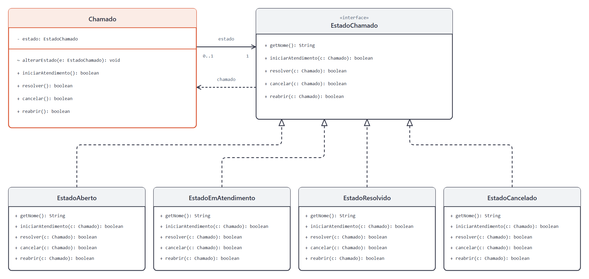

# DCC078 - Padrões de Projeto: State

**Aluno:** Felipe Lazzarini Cunha

## Tema

O projeto representa chamados de suporte técnico nos estados aberto, em atendimento, resolvido e cancelado. O State delega ao estado atual as regras para iniciar o atendimento, resolver, cancelar ou reabrir um chamado. Operações permitidas retornam `true`; operações bloqueadas retornam `false` e preservam o estado. O atendimento é simulado, sem integração com sistemas externos.

## Diagrama de Classes UML



## Estrutura do Projeto

- `Chamado`: contexto que mantém o estado atual e delega as operações.
- `EstadoChamado`: interface comum aos estados do chamado.
- `EstadoAberto`, `EstadoEmAtendimento`, `EstadoResolvido` e `EstadoCancelado`: estados concretos que definem as operações permitidas e realizam as transições.
- `ChamadoTest`: testes das transições, das operações bloqueadas e da independência entre chamados.

## Testes

Com JDK 11 ou superior e Maven:

```bash
mvn test
```
